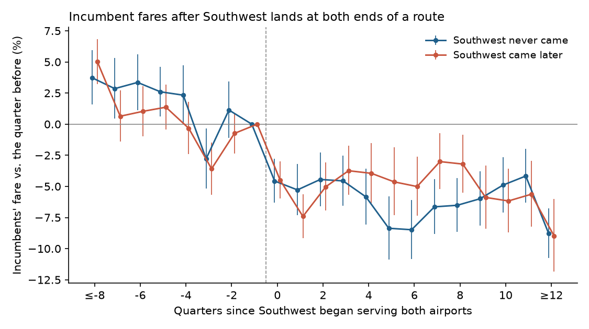
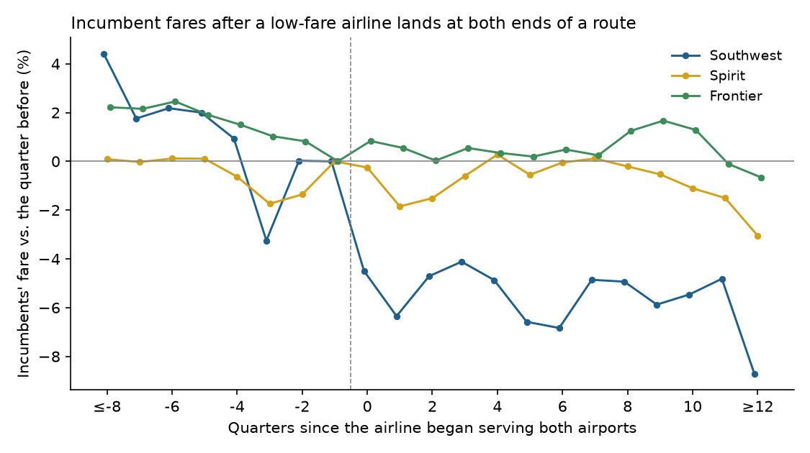

# The Fare Cut Before Southwest

### In 1982 Paul Milgrom and John Roberts asked why a dominant firm would cut its price for a rival that has not arrived yet, and whether the cut keeps the rival out. I asked again with eleven years of airline tickets.

---

In the year before Southwest Airlines began flying out of Cincinnati in the second quarter of 2017, a traveler
between Cincinnati and New York LaGuardia paid the airlines on that route an average of $352 each way, in 2024
dollars. Delta carried most of them. In the first year after Southwest arrived, the average fare paid to airlines
other than Southwest was $212. Part of that fall came from Frontier, which began selling the route in the same
quarter, but Delta, American and United on their own still went from $352 to $262. Southwest flew from both
airports, yet it never won even 5% of the passengers between them. On the route to Los Angeles, where Delta also
led, the network airlines' average fare fell from $404 to $363 over the same months, and by the end of
2018 Southwest was selling at least 5% of the tickets anyway.

Both drops happened before Southwest sold a meaningful number of seats on either route. Economists call a price cut
like that, made by a firm already in a market to change the mind of a firm thinking about joining it, limit
pricing. For three decades the standard models had simply assumed that a low price before entry discourages
entry. Then two game theorists who had met at Northwestern asked what a rational entrant should make of a price cut it knows is aimed at it, and
the answer changed how economists model entry and predation.

---

## Two measures

The first measure is how far a firm prices below what it would charge if no rival were waiting. In the paper's
worked example, a low-cost monopolist would sell 4.75 units at a price of 5.25. To prove it is low-cost, it sells
7.2 units instead, at a price of 2.80. The markdown is

```math
\text{markdown} = \frac{P^{m} - P^{\text{limit}}}{P^{m}} = \frac{5.25 - 2.80}{5.25} = 0.467
```

where $`P^{m}`$ is the price that maximizes this period's profit and $`P^{\text{limit}}`$ is the price actually
charged.

With airline data I cannot see what an incumbent would have charged without the threat, so I measure the change
instead. For route $`r`$, let $`\overline{\ln F}_{r,\text{before}}`$ be the incumbents' average log fare in the four
quarters before Southwest reached both airports and $`\overline{\ln F}_{r,\text{after}}`$ the average over up to four
quarters after, stopping if Southwest starts competing. Let $`\bar\phi`$ be the season-adjusted average log fare on
routes Southwest never reached, which nets out fuel prices and the business cycle. The threat-year fare change is

```math
\Delta_r = \big(\overline{\ln F}_{r,\text{after}} - \overline{\ln F}_{r,\text{before}}\big) - \big(\bar\phi_{\text{after}} - \bar\phi_{\text{before}}\big)
```

For Cincinnati to LaGuardia the incumbents' fares were $352 and $212, while routes Southwest never touched rose by
0.028 log points over the same quarters, so

```math
\Delta_{\text{CVG-LGA}} = (\ln 212.36 - \ln 352.23) - 0.028 = -0.506 - 0.028 = -0.534
```

Counting only the network airlines, which leaves Frontier's arrival out, the same calculation gives $`-0.321`$.

The second measure is the entry rate, the share of threatened routes on which the entrant shows up within three
years. The paper's point is that three different worlds predict three different patterns of price and entry.

| What the entrant knows | Price before entry | Which incumbents face entry |
|---|---|---|
| Everything (full information) | Each firm charges its own monopoly price | The high-cost ones |
| Only the price, and prices differ by cost (separating) | Low-cost firms cut, high-cost firms do not | The high-cost ones, exactly as often as with full information |
| Only the price, and every firm charges the same (pooling) | One price for all, so the high-cost firm cuts | Whoever the entrant's own costs allow |

---

## Milgrom and Roberts's question

Paul Milgrom was born in Detroit in 1948, trained as an actuary, and finished a Stanford doctorate before taking
his first academic job at the Kellogg School of Management at Northwestern University. There he met John Roberts,
born in Winnipeg in 1945 and educated at the University of Manitoba and the University of Minnesota, who had taught
at Kellogg since 1971 and moved to Stanford's Graduate School of Business in 1980. Their paper reached
*Econometrica* in March 1980 and appeared in March 1982. Milgrom shared the 2020 Nobel Memorial Prize with
Robert Wilson for auction theory. Roberts, who died in 2026 at 80, spent much of his later career applying the same
economics of information and incentives to how firms are organized.

The problem they took on was an argument by James Friedman. If an entrant knows the incumbent's costs and demand,
it can work out exactly what it would earn after entering, and nothing the incumbent charges today changes that
number. A price cut then squanders profit, so with complete information there is no limit pricing. Joe Bain's original intuition, that an entrant reads today's price as a hint about tomorrow's, needs
something the entrant does not know.

Milgrom and Roberts supplied it. The incumbent knows its own cost and the entrant does not. They assumed linear
demand $`P = a - bQ`$ with $`a = 10`$ and $`b = 1`$, an entry cost $`K = 7`$, an incumbent whose unit cost is either
$`\underline{c}_1 = 0.5`$ or $`\bar c_1 = 2`$, an entrant whose cost is either 1.5 or 2, and Cournot competition
with costs revealed once entry happens. Write $`\Pi^m(c)`$ for monopoly profit and $`R(c_1, c_2)`$ for what the
incumbent gains by keeping out an entrant of cost $`c_2`$. In a separating equilibrium the high-cost incumbent
charges its monopoly price and faces entry, so the low-cost incumbent must pick an output $`Q_L`$ large enough that
the high-cost one would not copy it even if copying stopped every entrant:

```math
\begin{aligned}
\Pi^m(\bar c_1) &\ge (a - bQ_L - \bar c_1)\,Q_L + R(\bar c_1, c_2) \\
16 &\ge (8 - Q_L)\,Q_L + 9.75 \\
Q_L^2 - 8\,Q_L + 6.25 &\ge 0 \;\Rightarrow\; Q_L \ge 7.12 \\
\Pr(\text{entry}) &= \Pr(c_1 = \bar c_1) = q
\end{aligned}
```

The low-cost firm limit prices, but because the entrant can invert the price back into the cost, entry happens in
exactly the cases it would have happened anyway. The paper's example uses $`Q_L = 7.2`$, and a pooling equilibrium,
where both types produce 4.75 and the entrant learns nothing, also exists for a wide range of beliefs. In the pooling case
entry depends only on the entrant's own cost.

Section 3 of the paper generalizes the point with one line of probability. Whatever the incumbent does, a rational
entrant's forecast of its profit, averaged over everything it might observe, equals its forecast with no
information at all:

```math
\mathbb{E}\big[\,\mathbb{E}[\Pi_2 \mid P_1,\, c_2]\;\big|\;c_2\big] = \mathbb{E}[\Pi_2 \mid c_2]
```

where $`\Pi_2`$ is the entrant's profit after entry, $`P_1`$ the price it sees and $`c_2`$ its own cost. The price
can move the entrant's beliefs route by route, but it cannot bias them on average. The authors concluded that, as
long as the price before entry does not change demand after it and two periods describe the market, limit pricing
"should not be discouraged, since it means lower prices and cannot, overall, limit entry."

The strongest objection is the one they raised themselves. The model has many equilibria, separating and pooling,
with different limit prices, and which one a market lands in depends on what the entrant conjectures. A theory
that allows less, the same or more entry than full information can be hard to reject. Testing it means finding the
sharper prediction, and the separating equilibrium has one. The incumbents that end up facing entry are the ones
that did not cut.

---

## How I tested it

The Bureau of Transportation Statistics publishes a 10% random sample of every domestic airline ticket each
quarter, the DB1B Origin and Destination Survey. I used all 44 quarters from 2014 through 2024, kept fares between
$25 and $2,500, dropped bulk fares, tickets sold by two airlines and itineraries with more than two connections,
and treated a route as a pair of airports in either direction. Routes had to be at least 100 miles long, appear in
at least 32 of the 41 usable quarters and average at least 100 sampled incumbent passengers a quarter. I dropped
2020 Q2 through Q4, when travel collapsed.

Southwest has regular service at an airport once it flies at least 300 sampled passengers a quarter to or from it, two
quarters running. A route is threatened in the first quarter Southwest has regular service at both ends without
competing on the route itself, and Southwest competes once it sells at least 5% of the route's tickets, by
connections or nonstop, or flies it nonstop, again two quarters running. That left 706 threatened routes, 349 routes
Southwest was already competing on by its first quarter at both ends, and 3,249 routes it never reached, which serve
as the comparison. The incumbents' fare is the average fare paid to every airline except Southwest. That average
can fall without anyone cutting a price, if a cheaper airline such as Frontier starts selling the route, so I also
ran the event study on the network airlines alone, leaving out Southwest, Spirit, Frontier, Allegiant and JetBlue.

The event study compares each threatened route with itself, quarter by quarter, around the threat.

```math
\begin{aligned}
\ln F_{rt} &= \sum_{k \ne -1} \tau_k\, \mathbf{1}[t - T_r = k] + \sum_{j=1}^{3} \lambda_j\, \mathbf{1}[t - E_r \in J_j] \\
&\quad + \alpha_{r,s(t)} + \phi_t + u_{rt}, \qquad H_0:\ \bar\tau \equiv \tfrac{1}{4}\textstyle\sum_{k=0}^{3}\tau_k = 0
\end{aligned}
```

where $`F_{rt}`$ is the incumbents' average fare in 2024 dollars on route $`r`$ in quarter $`t`$, $`T_r`$ the
threat quarter, $`E_r`$ the quarter Southwest began competing, $`J_j`$ the first, second and later years after
that, $`\alpha_{r,s(t)}`$ a separate effect for each route in each season, $`\phi_t`$ a national effect for each
quarter, and errors clustered by route. The $`\lambda_j`$ soak up whatever happens once Southwest is actually
selling seats, so $`\bar\tau`$ is the fare change during the threat alone. To test the separating prediction I let
the $`\tau_k`$ differ between routes Southwest later entered and routes it never entered, for threats that began by
the end of 2021. Separating says $`\bar\tau^{E} = 0`$ and $`\bar\tau^{N} < 0`$. Pooling says
$`\bar\tau^{E} = \bar\tau^{N}`$. Finally I asked whether bigger cuts kept Southwest out.

```math
\text{Enter}_r = \beta\,\Delta_r + \gamma' X_r + \delta_{y(r)} + e_r, \qquad H_0:\ \beta = 0
```

where $`\text{Enter}_r`$ is 1 if Southwest competed within twelve quarters of the threat, $`X_r`$ holds distance,
pre-threat traffic and Southwest's size at the newly served airport, and $`\delta_{y(r)}`$ is the year the threat
began. Standard errors are clustered by the newly served airport, since one new station threatens dozens of routes
at once. A separating equilibrium predicts $`\beta > 0`$, since larger cuts (more negative $`\Delta_r`$) would go with less
entry.

---

## Incumbents cut fares about 5% when Southwest arrives at both ends

The threat-year estimate, with its 95% interval and sample size, is

```math
\bar\tau = -0.0505\ (0.0062),\quad 95\%\ \text{CI}\ [-0.063,\ -0.038],\quad N = 159{,}116 \text{ route-quarters}
```

In the first year after Southwest reached both airports, incumbents' fares on the 706 threatened routes fell by
about 4.9% relative to routes it never reached. From four to two quarters before the threat they averaged within a
point of the quarter just before ($`-0.008`$, standard error 0.006), although five to seven quarters out they sat about
2% higher and eight or more quarters out about 4% higher, so part of the gap is a slow drift that began earlier.
Counting only the network airlines gives $`-0.051`$ (0.006) on 705 threatened routes, so the cut is not an artifact
of other low-fare airlines growing on the same routes. Clustering by the newly served airport raises the standard error to 0.018. Threats that began between 2015 and 2019,
before the pandemic, show a smaller cut of 0.036 log points (0.008), and those from 2021 on show 0.067 (0.010).

Once Southwest began competing, incumbents' fares changed by only 0.007 log points (0.009) more in the first year.
Austan Goolsbee and Chad Syverson found the same timing for an earlier period, with over half of Southwest's effect
on incumbents' fares arriving before it started flying. In the paper's example the low-cost incumbent expands
output by half. Incumbents here carried 2.7% more passengers in the threat year, an increase the data cannot
distinguish from zero.

| Newly served airport | Threat began | Routes threatened | Average fare change | Network airlines only | Southwest competing within 3 years |
|---|---|---|---|---|---|
| Chicago O'Hare | 2021 Q1 | 80 | −8.8% | −10.1% | 22.5% |
| Honolulu | 2019 Q1 | 70 | −0.9% | −1.0% | 44% |
| Houston Bush | 2021 Q2 | 70 | −6.6% | −7.4% | 27% |
| Cincinnati | 2017 Q2 | 50 | −15.4% | −13.7% | 56% |
| Savannah | 2021 Q1 | 45 | −5.9% | −7.7% | 40% |
| Kahului, Maui | 2019 Q2 | 44 | −1.7% | −2.1% | 52% |
| Syracuse | 2021 Q4 | 43 | −10.2% | −10.3% | 42% |
| Kona | 2019 Q2 | 39 | +4.3% | +4.0% | 59% |
| Destin–Fort Walton Beach | 2021 Q2 | 37 | −6.3% | −4.1% | 49% |
| Lihue, Kauai | 2019 Q4 | 33 | +5.0% | +4.7% | 67% |
| Eugene | 2021 Q3 | 31 | +5.3% | +4.7% | 68% |
| Bozeman | 2021 Q2 | 30 | −8.8% | −9.7% | 80% |

*Every airport where Southwest's arrival threatened at least 30 routes. Fare changes are the airport's average
$`\Delta_r`$, net of routes Southwest never reached, converted to percent. The network column leaves out Spirit,
Frontier, Allegiant and JetBlue as well as Southwest.*

The cuts came on the mainland. On the Hawaiian islands, where Southwest arrived in 2019, and at Eugene, the
incumbents' fares barely moved or rose.

---

## The routes Southwest later entered got the same cut

If the cut were a separating signal, the incumbents that later faced Southwest would be the ones that had not cut,
because their fares would have revealed them as weak. The two threat-year estimates and their difference are

```math
\bar\tau^{E} = -0.053\ (0.008),\qquad \bar\tau^{N} = -0.048\ (0.010),\qquad \bar\tau^{E} - \bar\tau^{N} = -0.005\ (0.012)
```

On the 362 threatened routes Southwest later entered, incumbents cut fares by 5.2% in the threat year. On the 344
it never entered, they cut by 4.7%. The difference is half a percentage point and its 95% interval runs from a
2.9-point larger cut on entered routes to a 1.9-point smaller one. Restricting to threats that began before 2020
makes the separating story look worse, with a 4.5% cut on the 152 routes Southwest later entered and a 1.9% cut,
not significant, on the 97 it did not.



Where Southwest came, it came fast, a median of three quarters after it reached both airports. It competed within
three years on 48% of threatened routes but flew nonstop on only 6%, so most of that competition came through
connections.

---

## Bigger cuts did not keep Southwest out

The second test asks the question in the paper's title directly. Sorting threatened routes by how far incumbents'
fares fell in the threat year, the share Southwest went on to compete on is flat.

| Threat-year fare change | Routes | Average change | Southwest competing within 3 years |
|---|---|---|---|
| Largest cuts | 176 | −20.5% | 47% |
| Second quarter | 175 | −7.4% | 47% |
| Third quarter | 175 | 0.0% | 53% |
| Smallest cuts or rises | 175 | +10.3% | 45% |

```math
\hat\beta = 0.009\ (0.223),\quad p = 0.97,\quad N = 701 \text{ routes},\ 21 \text{ airports}
```

Adding distance, traffic and Southwest's size at the new airport moves the estimate to $`-0.224`$ (0.209), and
restricting to routes Southwest did not enter in the first year gives $`-0.087`$ (0.179). Neither has the positive
sign deterrence would need. Holding distance and traffic fixed, routes with lower incumbent fares during the threat were more likely to see Southwest compete
(a coefficient of $`-0.75`$ on the log fare, standard error 0.15), probably because low fares for the distance mark
the leisure markets where Southwest's customers are.

| Largest incumbent before the threat | Routes | Average fare change | Southwest competing within 3 years |
|---|---|---|---|
| American | 240 | −5.8% | 50% |
| United | 208 | −5.2% | 34% |
| Delta | 118 | −6.7% | 50% |
| Alaska | 45 | +2.4% | 62% |
| Allegiant | 28 | −4.6% | 61% |
| Hawaiian | 27 | −2.3% | 78% |
| JetBlue | 12 | 0.0% | 67% |

The three big network carriers cut fares by 5 to 7% and still saw Southwest on a third to a half of their
threatened routes. Alaska and Hawaiian cut little or not at all and saw it more often, the direction a separating
equilibrium points, but all of Hawaiian's routes come from Southwest's single push into the islands in 2019 and early
2020.

---

## Spirit and Frontier draw almost no response

The obvious follow-up is whether incumbents treat every low-fare airline this way. I ran the same design with
Spirit and with Frontier as the potential entrant, counting Southwest among the incumbents.

```math
\bar\tau_{\text{Spirit}} = -0.011\ (0.003),\quad N_r = 1{,}188, \qquad \bar\tau_{\text{Frontier}} = 0.005\ (0.002),\quad N_r = 2{,}772
```

Incumbents cut fares by about 1% when Spirit arrived at both ends of a route, and the cut disappears for threats
that began before 2020 (0.001, standard error 0.005). Even the 1% is hard to read as a response, because fares on
those routes were already drifting down by about as much in the quarters before Spirit arrived ($`-0.013`$, standard
error 0.003). For Frontier the estimate is a rise of half a percent. Both
airlines were also far less likely than Southwest to follow through, competing within three years on 24% and 12%
of their threatened routes.



In the model, limit pricing pays only when keeping the entrant out is worth something, and an airline that sells
mostly to travelers who would not otherwise fly takes less from incumbents than Southwest does. The data fit that
reading but cannot rule out simpler ones, such as differences in which routes each airline surrounds.

---

## Why it matters

For travelers, the threat is worth real money. A route Southwest has surrounded but not yet entered is about 5%
cheaper in the first year, and on routes out of Cincinnati in 2017 the drop averaged 15%, or 14% counting only the
network airlines. Those savings arrive whether or not Southwest ever competes for the route.

For the airlines already in place, the cut buys little. Routes where incumbents cut hardest were entered as often
as routes where they did not cut at all, so the lower fares went to passengers without changing Southwest's plans.

For airlines trying to break in, a falling fare on a target route says little about how hard the incumbent will
fight, and Southwest's entry decisions here look unaffected by it.

For policy, the result supports the paper's own conclusion. A low price set ahead of entry is not, by itself,
evidence that competition is being shut out, and here it was not.

---

## Limits of this study

The ticket sample shows what passengers paid, never what it cost the airline to fly them, so I cannot tell low-cost
incumbents from high-cost ones, which is the private information the theory turns on. "Entry" here means Southwest
selling 5% of a route's tickets, often through connections, a weaker commitment than the model's sunk entry cost,
and other thresholds would change the counts. Southwest picked growing airports, where incumbent traffic was already
rising before the threat, and fares were drifting down slowly before many threats, so the comparison routes are an
imperfect stand-in. Of the 706 threats, 447 began in 2021, during an uneven recovery. The incumbents' fare is an
average over airlines, so it moves when the mix of airlines changes; dropping the low-fare airlines guards against
one such shift but not against changes among the network carriers. And the absence of a link between cuts and entry
holds for these routes and this entrant. It fits a pooling equilibrium or no signaling at all, and it does not
prove that no incumbent ever deterred anyone.

---

## Further reading

- [TECHNICAL.md](TECHNICAL.md) has the data files, the rules fixed before seeing results, every test statistic and
  how to reproduce the analysis.
- [results/FINDINGS.md](results/FINDINGS.md) has a plain-English summary and every table the scripts produce.
- [METHODS_REVIEW.md](METHODS_REVIEW.md) is a methods and reporting review of the original paper.
- The original paper is Paul Milgrom and John Roberts, "Limit Pricing and Entry under Incomplete Information: An
  Equilibrium Analysis," *Econometrica* 50(2), March 1982, pp. 443–459.
- Austan Goolsbee and Chad Syverson, "How Do Incumbents Respond to the Threat of Entry? Evidence from the Major
  Airlines," *Quarterly Journal of Economics* 123(4), 2008, pp. 1611–1633 (NBER Working Paper 11072).
- Paul Milgrom's autobiography on NobelPrize.org (2020), John Roberts's faculty page at the Stanford Graduate
  School of Business and the school's March 27, 2026 news item on his death are the sources for the biographical
  details.
- Ticket data come from the Bureau of Transportation Statistics, Airline Origin and Destination Survey (DB1B
  Market), 2014 Q1 to 2024 Q4, at transtats.bts.gov. The consumer price index (CPIAUCSL) comes from FRED, Federal
  Reserve Bank of St. Louis, downloaded November 1, 2026.

*Brendyn Beasley*
